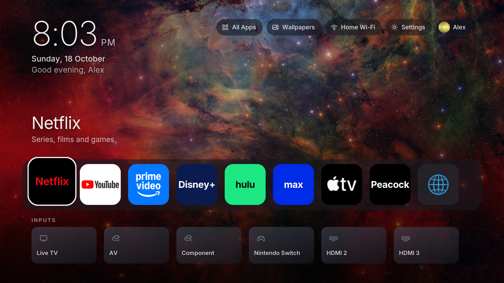
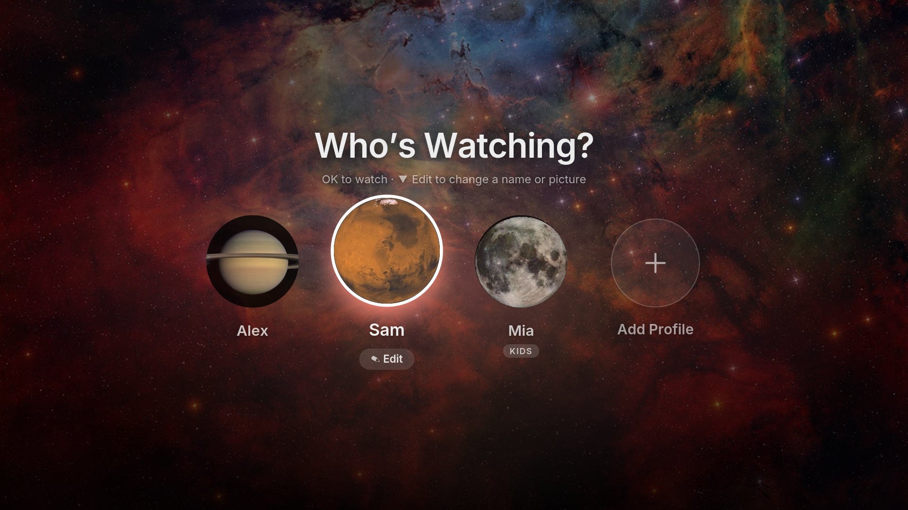
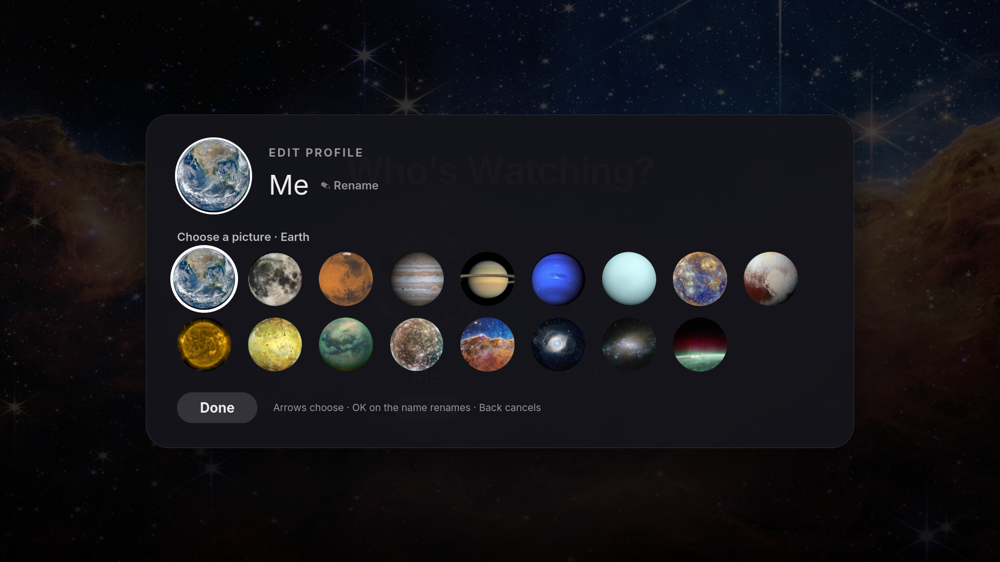
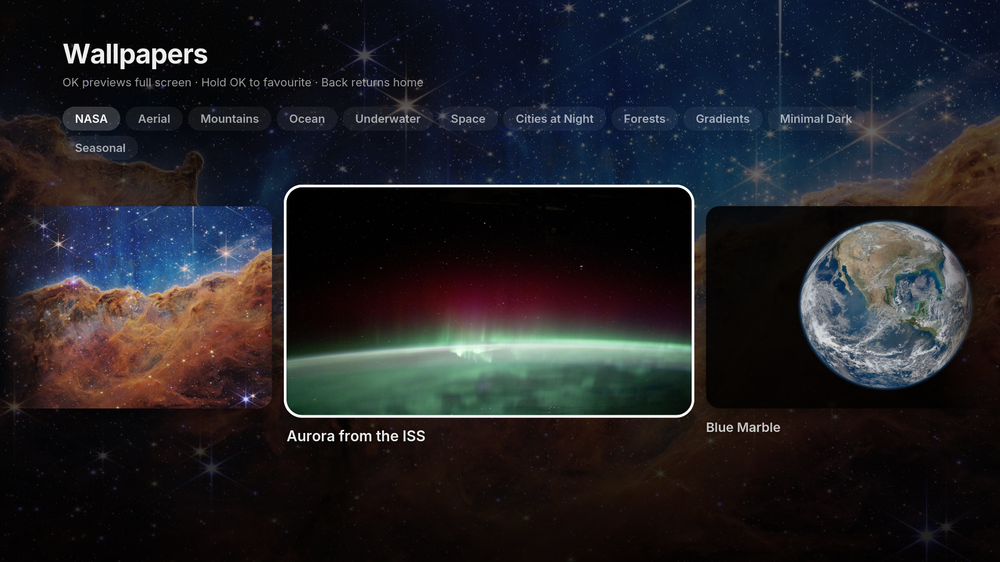
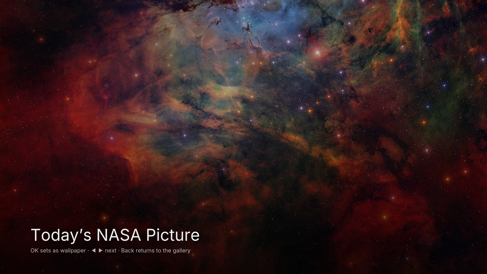

# webOS tvOS Launcher

A cinematic, Apple TV–inspired home screen for LG webOS TVs: real NASA wallpapers,
household profiles with space pictures, a magnifying app dock and a screensaver. It runs
as a normal app in LG's Developer Mode, so no root and no changes to the TV's system.



All screenshots were taken on a real TV: an LG 65UM7300AUE (2019, webOS 4.5).

## What it does

- **Who's Watching?** Each person in the household gets a profile with their own name,
  picture, accent colour, wallpaper and app dock. A short greeting plays when you pick one.
  The picker comes back only after four hours away, never when you hop out of an app.
- **Real space pictures.** Profile pictures are NASA photos of the planets, moons, the Sun
  and nebulas. Edit a profile from the picker: press Down to reach **Edit**.
- **NASA wallpapers.** Six built-in NASA photos (Webb's Cosmic Cliffs, the aurora from the
  ISS, Blue Marble and more), plus **Today's NASA Picture**, which shows NASA's Astronomy
  Picture of the Day and changes daily. More than 25 original vector scenes fill the other
  collections (mountains, oceans, cities at night, seasons and so on).
- **A dock that feels alive.** The focused app lifts and glows, its neighbours lift a
  little, and the app's brand colour washes in behind its name.
- **Inputs as cards.** Live TV and the HDMI ports, with the names set on the TV.
- **Quick controls.** All Apps, Wallpapers, Wi-Fi (shows your network) and Settings.
- **Number keys.** Press 1–9 on the home screen to open that app in the dock.
- **Screensaver.** A NASA photo slideshow with a drifting clock, dimmed to protect OLED
  screens.
- **Kids profiles.** A simple home screen that needs a household PIN to leave. This
  works inside the launcher only; for real parental controls use the TV's
  Settings → General → Safety.
- **Fast on old TVs.** On webOS 4 the launcher switches to a lighter mode automatically.
  On the test TV it idles at 60 fps and answers a button press in about 50 ms.

<p>




</p>

## Install

You need an LG webOS TV, a computer on the same network, and Node 18 or later.

1. **On the TV, turn on Developer Mode.** Create a free account at
   [webostv.developer.lge.com](https://webostv.developer.lge.com), install the
   **Developer Mode** app from the LG Content Store, sign in, and turn on **Dev Mode
   Status**. After the restart, open the app again and turn on **Key Server**.
2. **On the computer, connect to the TV** (use the IP address and passphrase shown in the
   Developer Mode app):

   ```sh
   npm install
   npx ares-setup-device -a tv -i "host=<tv-ip>" -i "port=9922" -i "username=prisoner"
   npx ares-novacom --device tv --getkey
   ```

3. **Build and install:**

   ```sh
   npm run install:devmode
   ```

Open **Home** from LG's app bar. To make it quicker to reach, hold **0** on the remote to
set up Quick Access, assign a number to Home, then hold that number from anywhere.

### Keeping Developer Mode on

LG ends a Developer Mode session after a set time and removes sideloaded apps when it does.
At install time the script copies the TV's session token into the app, and the launcher
then renews the session itself, just as the **Extend** button does. It renews at most
every 12 hours while it's running, so open the launcher at least every couple of days.
Settings → System → **Keep Developer Mode on** shows the last renewal. The token stays on
the TV and on your computer (`public/devmode.json` is git-ignored); it is only ever sent to
LG's renewal address.

### Backups

Profiles and settings live inside the app on the TV. Save a copy (the launcher must be
on screen):

```sh
npm run backup                          # → backups/settings-<date>.json
npm run restore backups/<file>.json     # writes it back and reloads the launcher
```

`npm run install:devmode` also takes a backup before every install.

## Limits, honestly

- **The Home button still opens LG's menu.** Only a rooted TV can remap it. Use Back to
  leave apps, which usually returns to the launcher, or a Quick Access number.
- **Which apps appear.** Sideloaded apps can't list what's installed, so the launcher ships
  a catalogue of app IDs ([src/config/catalog.ts](src/config/catalog.ts)) and shows the
  ones the TV has. Add your own in `src/config/catalog.local.ts` (see the example file).
- **No uninstalling from here.** Remove apps from LG's app bar: hold OK on an app, then
  press Up to the X.
- **Tested on one TV.** Developed and measured on webOS 4.5 (Chrome 53). Newer webOS
  versions should work, since the build targets that oldest engine, but haven't been
  tried.

## Development

```sh
npm run dev        # preview in a desktop browser with sample data
npm run build      # type-check and build dist/ (Chrome 53, classic script)
npm run package    # dist/ → build/*.ipk
```

With Developer Mode on, the TV's web inspector is at `http://<tv-ip>:9998`.

## Credits

- Built on [partridgeworks/webos-launcher](https://github.com/partridgeworks/webos-launcher)
  (MIT), which provided the remote navigation, Luna calls, input handling and packaging.
- Photos: NASA. Sources and IDs in [public/wallpapers/CREDITS.txt](public/wallpapers/CREDITS.txt).
- Design inspiration: Apple tvOS, [bencho.dev](https://bencho.dev) for motion, and an
  Apple TV+ site clone for the full-width hero. No code or artwork was copied from any of them.
- Not affiliated with LG, Apple or NASA. See [THIRD_PARTY_NOTICES.md](THIRD_PARTY_NOTICES.md).

## Licence

MIT, see [LICENSE](LICENSE). Third-party material is listed in
[THIRD_PARTY_NOTICES.md](THIRD_PARTY_NOTICES.md).
